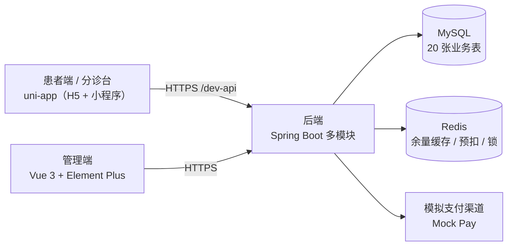

# 号源 QueueDepth · 门诊预约挂号系统

> 一套可跑通、可讲解、可复现的全栈演示系统：患者端预约挂号全链路、分诊台签到与停诊、管理端运营看板与对账。
> **数据全部虚构，支付走模拟渠道，不提供任何真实医疗服务。**

本仓是**门面仓**（第 5 个仓）：只放 README、截图与截图脚本。代码在四个独立仓，见文末仓库表。


## 这套系统有什么

| 模块 | 能力 |
|---|---|
| 患者端（uni-app，H5 + 小程序） | 选院区 → 科室 → 医生 → 排班 → 选时间 → 确认预约 → 支付 → 就诊码 → 退号；就诊人管理、收藏、站内信 |
| 分诊台（同一 App 内的双角色） | 扫码签到 / 手动补签、当日签到列表、停诊上报（按排班 / 医生某日 / 院区某日） |
| 管理端（Vue 3 + Element Plus） | 20 张业务表维护、运营看板、号源台账、停诊处理、七查对账、黑名单与限购 |
| 后端（Spring Boot 多模块） | 20 表领域模型、Redis 预扣 + DB 单柱 CAS 三层防线、状态机闭环、模拟支付渠道 |

技术栈：`uni-app (Vue 3 + TS)` / `Vue 3 + Element Plus + Vite` / `Spring Boot + MyBatis-Plus + Sa-Token` / `MySQL + Redis`。

## 架构



## 关键截图（全部由脚本产出，禁止手工截）

| 患者端 | 分诊台 | 管理端 |
|---|---|---|
|  |  |  |
|  |  |  |

更多：`assets/screenshots/`（患者 5 张 / 分诊 2 张 / 后台 3 张）。重出方式见 `tools/screenshots/README.md`。

## 快速开始

前置：JDK 21、Node ≥ 20、MySQL 8、Redis 7（或用 `backend/deploy/docker-compose.yml` 起依赖）。

```bash
# 1) 后端（8082）
cd qd-appt-backend && ./mvnw -pl ruoyi-admin -am compile -DskipTests && <你的启动方式>

# 2) 管理端（8083）
cd qd-appt-admin && pnpm install && pnpm dev

# 3) 患者端 H5（8084）
cd qd-appt-app && pnpm install && pnpm dev:h5
```

数据库初始化脚本、seed 数据与完整启动说明见 [`qd-appt-docs`](../qd-appt-docs) 仓的 `README.md`。

## 演示账号

| 角色 | 账号 | 密码 |
|---|---|---|
| 患者 | `admin` | `admin123` |
| 分诊 | `appt_triage` | `admin123` |
| 管理端 | `admin` | `admin123` |

5 分钟怎么讲、每步点哪里、卡点怎么办：见 [`docs/DEMO.md`](../qd-appt-docs/blob/main/DEMO.md)。

## 接口文档

- OpenAPI JSON：`http://localhost:8082/v3/api-docs`
- 分组：`1.门诊预约业务` / `2.系统与权限` / `3.通用能力` / `4.代码生成`
  （`/v3/api-docs/1.门诊预约业务`）
- 本项目未引 Swagger UI 依赖，`/doc.html` 不存在；用 Apifox / Insomnia / Postman **导入 JSON** 浏览。

## 设计取舍（节选）

| 决策 | 一句话 | 详情 |
|---|---|---|
| 限购口径 | 同一就诊人同一就诊日 1 单，跨院区共享 | [ADR-0001](../qd-appt-docs/blob/main/adr/ADR-0001-purchase-limit-scope.md) |
| 停诊两段式 | 登记不动号源，处理才回池退款 | [ADR-0002](../qd-appt-docs/blob/main/adr/ADR-0002-suspend-two-phase-and-batch-idempotency.md) |
| 号源不物理删除 | `active_flag` + 有效行唯一索引 | [ADR-0003](../qd-appt-docs/blob/main/adr/ADR-0003-active-flag-and-unique-index.md) |
| 停诊范围复合键 | `scope_type + scope_value`，Service 集中构造 | [ADR-0004](../qd-appt-docs/blob/main/adr/ADR-0004-scope-value-composite-key.md) |
| 时刻口径 | 后端统一 `HH:mm`，前端不再截断 | [ADR-0005](../qd-appt-docs/blob/main/adr/ADR-0005-time-point-format.md) |
| 三层防线 | Redis 预扣 / DB 单柱 CAS / 应用重试 | [ADR-0006](../qd-appt-docs/blob/main/adr/ADR-0006-three-layer-defense.md) |

**并发与缓存的实际数据不写在这里**（避免文档双权威）：见 `qd-appt-docs` 的 `test-evidence.md` §2（主链路）、
§3（摘除防线的对照实验）、§7.2（延迟分位）。

## 仓库

| 仓 | 内容 | 本地路径 |
|---|---|---|
| `qd-appt-app` | 患者端 + 分诊台（uni-app） | `~/projects/qd-appt/app` |
| `qd-appt-admin` | 管理端（Vue 3 + Element Plus） | `~/projects/qd-appt/admin` |
| `qd-appt-backend` | 后端（Spring Boot 多模块） | `~/projects/qd-appt/backend` |
| `qd-appt-docs` | 文档单一权威（契约 / 设计 / 排期 / 证据） | `~/projects/qd-appt/docs` |
| `qd-appt-showcase` | 本仓：门面、截图、截图脚本 | `~/projects/qd-appt/showcase` |

> 本地路径按「四个仓平级 clone 到同一目录」书写，按你的实际放置调整即可。

## 已知边界（如实说明）

- **虚构数据**：院区、科室、医生、患者全部为演示数据，地址与姓名均为虚构。
- **模拟支付**：`Mock Pay` 渠道，无真实资金流；退款同样走模拟。
- **未接第三方登录**：登录页只保留账号密码 + 图形验证码，社交登录入口已移除（后端未配置客户端）。
- **示例页保留但不可见**：`views/demo`、`views/ai`、`views/workflow` 等框架示例页文件仍在，菜单已隐藏。
- **小程序截图不脚本化**：真机界面需手工截，清单见 `docs/DEMO.md` 附录。
- **无 Swagger UI**：只提供 OpenAPI JSON（见上）。

## 物料重出

```bash
cd tools/screenshots
pnpm install                     # 首次：PLAYWRIGHT_SKIP_BROWSER_DOWNLOAD=1
node run.mjs --shots             # 10 张单页截图
node run.mjs --all               # 含流程与 GIF（需三端在跑）
```

脚本纪律（禁 `sleep`、固定视口、产物阈值）见本仓 `AGENTS.md` §2–§3。
