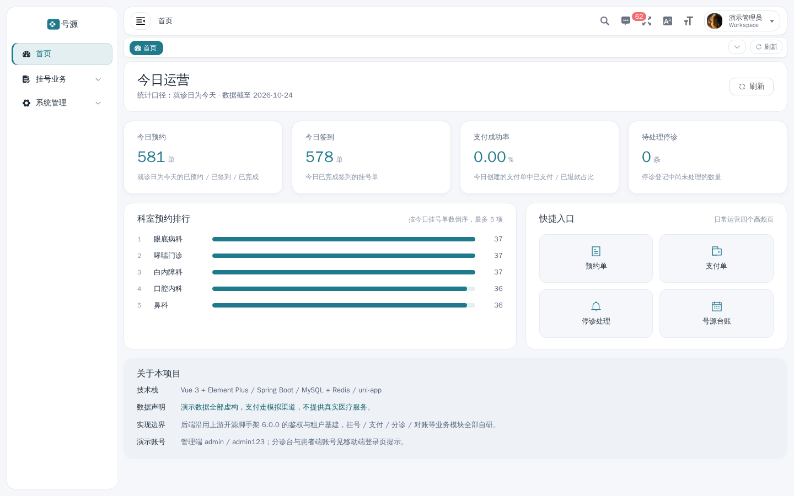
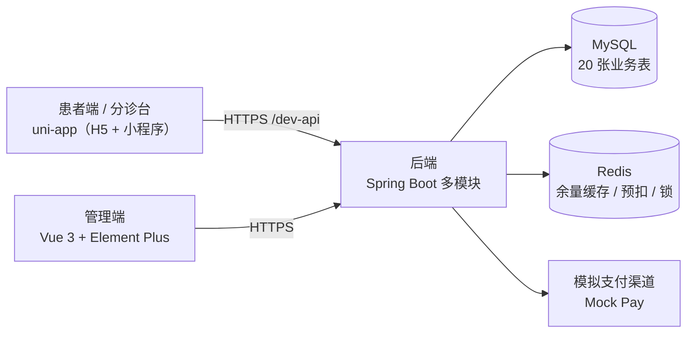
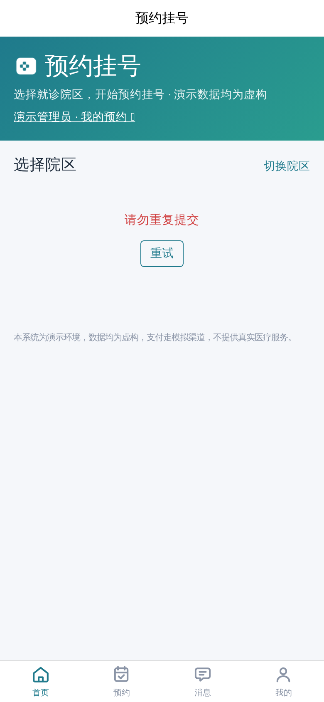
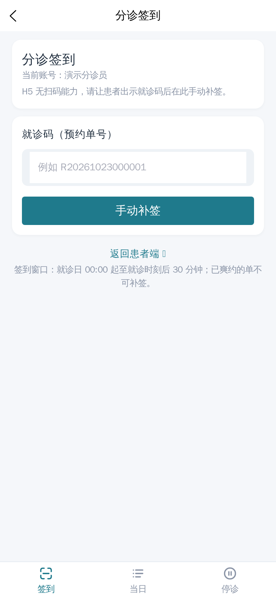
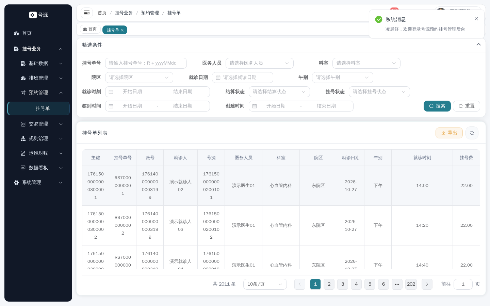
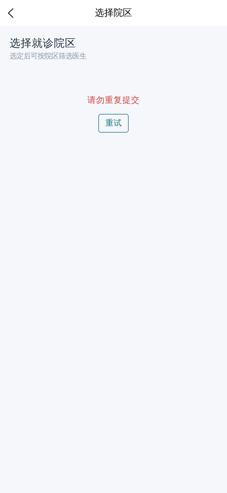
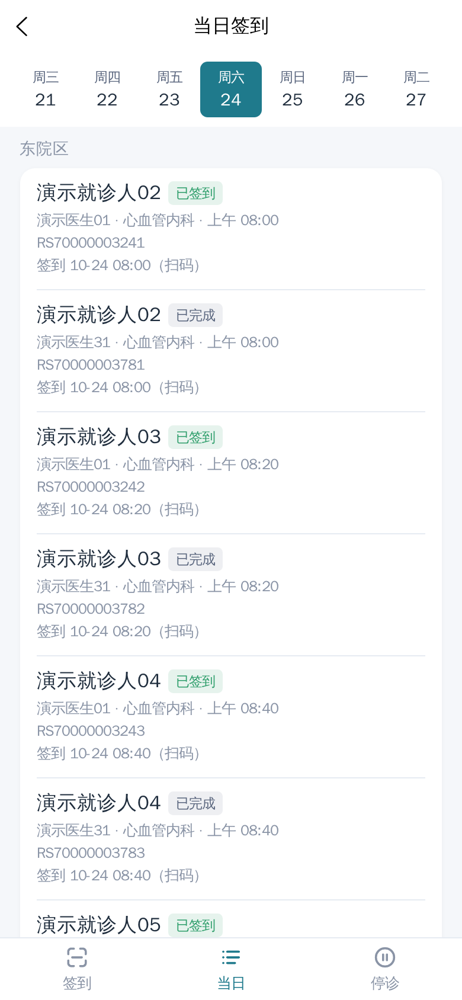
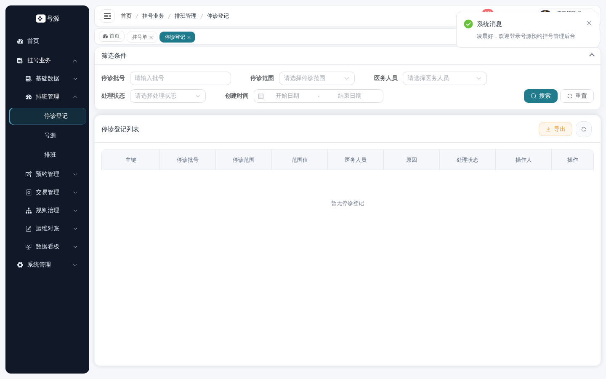

# 号源 QueueDepth · 门诊预约挂号系统

> 一套可跑通、可讲解、可复现的全栈演示系统：患者端预约挂号全链路、分诊台签到与停诊、管理端运营看板与对账。
> **数据全部虚构，支付走模拟渠道，不提供任何真实医疗服务。**

本仓是**门面仓**（第 5 个仓）：只放 README、截图与截图脚本。代码在四个独立仓，见文末仓库表。



## 这套系统有什么

| 模块 | 能力 |
|---|---|
| 患者端（uni-app，H5 + 小程序） | 选院区 → 科室 → 医生 → 排班 → 选时间 → 确认预约 → 支付 → 就诊码 → 退号；就诊人管理、收藏、站内信 |
| 分诊台（同一 App 内的双角色） | 扫码签到 / 手动补签、当日签到列表、停诊上报（按排班 / 医生某日 / 院区某日） |
| 管理端（Vue 3 + Element Plus） | 20 张业务表维护、运营看板、号源台账、停诊处理、七查对账、黑名单与限购 |
| 后端（Spring Boot 多模块） | 20 表领域模型、Redis 预扣 + DB 单柱 CAS 三层防线、状态机闭环、模拟支付渠道 |

技术栈：`uni-app (Vue 3 + TS)` / `Vue 3 + Element Plus + Vite` / `Spring Boot + MyBatis-Plus + Sa-Token` / `MySQL + Redis`。

## 架构



## 关键截图（全部由脚本产出，禁止手工截）

| 患者端 | 分诊台 | 管理端 |
|---|---|---|
|  |  |  |
|  |  |  |

更多：`assets/screenshots/`（患者 5 张 / 分诊 2 张 / 后台 3 张）。重出方式见 `tools/screenshots/README.md`。

### 主流程（15 秒，脚本录制）


首页 → 选院区 → 科室 → 医生 → 排班 → 选时间，全程真实点击，末尾停在「下一步」前（**不提交订单**，
避免占用「同一就诊人同一就诊日 1 单」的演示额度）。

## 快速开始

前置：**只装 Docker**（含 compose ≥2.20）。五个仓同级 clone：

```bash
mkdir -p qd-appt && cd qd-appt
for r in backend admin app docs showcase; do git clone git@github.com:xcqj/qd-appt-$r.git; done
cd showcase && ./demo.sh
```

脚本依次做七件事：检查 Docker / 端口 → 拉取或本地构建四镜像 → 起 MySQL / Redis / MinIO → 建库并导入演示数据
→ 建 MinIO bucket → 起后端 / 后台 / H5 → 逐端探活。就绪后打印三个地址与账号：

| 入口 | 地址 | 账号 |
|---|---|---|
| 患者端 H5 | `http://localhost:18084` | `admin / admin123` |
| 分诊台（同一 H5） | 同上，登录 `appt_triage / admin123` | `appt_triage / admin123` |
| 管理后台 | `http://localhost:18083` | `admin / admin123` |
| 后端 OpenAPI | `http://localhost:18082/v3/api-docs` | — |
| SnailJob 控制台 | `http://localhost:18800/snail-job` | `admin / admin` |

首次约 2–8 分钟（取决于是否命中镜像缓存），复跑约 1 分钟。常用子命令：`./demo.sh down`（停止，保留数据）、
`./demo.sh reset`（清数据卷）、`./demo.sh logs`。

**端口约定**：演示态固定 `18082 / 18083 / 18084`，与开发态的 `8082 / 8083 / 8084` 永不重叠（同一个端口被开发服务器占着时，
隧道就会指向热更新服务而不是构建产物）。若 18xxx 也被占用，脚本按 `+10000` 自动避让并打印实际地址；想彻底钉死就把端口写进
`showcase/deploy/.env`（模板见 `.env.example`）。

### 部署（与演示共用同一套服务定义）

`demo.sh` 是「从源码起一套给人看」；`deploy/deploy.sh` 是「拉已发布镜像起一套可回滚的」。两者读同一组
`deploy/compose*.yml`，差别只有一处：**部署链路永远不带 `compose.build.yml`**。

```bash
cp deploy/.env.example deploy/.env         # 首次：填 TAG / 口令
./deploy/deploy.sh wsl up --tag v0.1.0     # 拉镜像 → 记 previous → 起栈 → 探活 → 写 .state/current
./deploy/deploy.sh wsl status              # 容器状态 + 当前/上一版本 + 探活
./deploy/deploy.sh wsl rollback            # 回到 .state/previous 那一版
./deploy/deploy.sh wsl backup              # mysqldump + MinIO 打包（默认保留 7 份）
./deploy/deploy.sh wsl down | logs
```

- 镜像 tag 不可变（`v0.1.0` / `sha-xxxxxxx`），**禁止用 `latest` 部署**：回滚就是把 previous 的 tag 重新拉起来；
- `.state/current`、`.state/previous` 记录 tag 与镜像 digest；
- **目录约定（重要）**：`showcase/deploy/` 只放源码；真正的运行目录是 `~/qd-appt-deploy/`
  （由 CI 用 `rsync` 同步源码，但**不覆盖** `.env` 与 `.state`）。数据目录用**绝对路径**写进 `.env`
  （`APPT_DATA_DIR`），因为 `demo.sh` 与 `deploy.sh` 共用同一套栈——相对路径会各自解析到不同位置，
  起出一个空库，api 直接缺表起不来；

不想用 Docker 时，手工启动（JDK 21 + Node ≥ 20）见 [`qd-appt-docs`](https://github.com/xcqj/qd-appt-docs) 的「启动与演示」。

## 演示账号

| 角色 | 账号 | 密码 |
|---|---|---|
| 患者 | `admin` | `admin123` |
| 分诊 | `appt_triage` | `admin123` |
| 管理端 | `admin` | `admin123` |

5 分钟怎么讲、每步点哪里、卡点怎么办：见 [`docs/DEMO.md`](https://github.com/xcqj/qd-appt-docs/blob/main/DEMO.md)。

## 接口文档

- OpenAPI JSON：`http://localhost:8082/v3/api-docs`
- 分组：`1.门诊预约业务` / `2.系统与权限` / `3.通用能力` / `4.代码生成`
  （`/v3/api-docs/1.门诊预约业务`）
- 本项目未引 Swagger UI 依赖，`/doc.html` 不存在；用 Apifox / Insomnia / Postman **导入 JSON** 浏览。

## 设计取舍（节选）

| 决策 | 一句话 | 详情 |
|---|---|---|
| 限购口径 | 同一就诊人同一就诊日 1 单，跨院区共享 | [ADR-0001](https://github.com/xcqj/qd-appt-docs/blob/main/adr/ADR-0001-purchase-limit-scope.md) |
| 停诊两段式 | 登记不动号源，处理才回池退款 | [ADR-0002](https://github.com/xcqj/qd-appt-docs/blob/main/adr/ADR-0002-suspend-two-phase-and-batch-idempotency.md) |
| 号源不物理删除 | `active_flag` + 有效行唯一索引 | [ADR-0003](https://github.com/xcqj/qd-appt-docs/blob/main/adr/ADR-0003-active-flag-and-unique-index.md) |
| 停诊范围复合键 | `scope_type + scope_value`，Service 集中构造 | [ADR-0004](https://github.com/xcqj/qd-appt-docs/blob/main/adr/ADR-0004-scope-value-composite-key.md) |
| 时刻口径 | 后端统一 `HH:mm`，前端不再截断 | [ADR-0005](https://github.com/xcqj/qd-appt-docs/blob/main/adr/ADR-0005-time-point-format.md) |
| 三层防线 | Redis 预扣 / DB 单柱 CAS / 应用重试 | [ADR-0006](https://github.com/xcqj/qd-appt-docs/blob/main/adr/ADR-0006-three-layer-defense.md) |

**并发与缓存的实际数据不写在这里**（避免文档双权威）：见 `qd-appt-docs` 的 `test-evidence.md` §2（主链路）、
§3（摘除防线的对照实验）、§7.2（延迟分位）。

## 仓库

| 仓 | 内容 | 本地路径 |
|---|---|---|
| `qd-appt-app` | 患者端 + 分诊台（uni-app） | `~/projects/qd-appt/app` |
| `qd-appt-admin` | 管理端（Vue 3 + Element Plus） | `~/projects/qd-appt/admin` |
| `qd-appt-backend` | 后端（Spring Boot 多模块） | `~/projects/qd-appt/backend` |
| `qd-appt-docs` | 文档单一权威（契约 / 设计 / 排期 / 证据） | `~/projects/qd-appt/docs` |
| `qd-appt-showcase` | 本仓：门面、截图、截图脚本 | `~/projects/qd-appt/showcase` |

> 本地路径按「五个业务仓平级 clone 到同一目录」书写，按你的实际放置调整即可。

## 已知边界（如实说明）

- **虚构数据**：院区、科室、医生、患者全部为演示数据，地址与姓名均为虚构。
- **模拟支付**：`Mock Pay` 渠道，无真实资金流；退款同样走模拟。
- **未接第三方登录**：登录页只保留账号密码 + 图形验证码，社交登录入口已移除（后端未配置客户端）。
- **示例页保留但不可见**：`views/demo`、`views/ai`、`views/workflow` 等框架示例页文件仍在，菜单已隐藏。
- **小程序截图不脚本化**：真机界面需手工截，清单见 `docs/DEMO.md` 附录。
- **无 Swagger UI**：只提供 OpenAPI JSON（见上）。

## 物料重出

```bash
cd tools/screenshots
pnpm install                     # 首次：PLAYWRIGHT_SKIP_BROWSER_DOWNLOAD=1
node run.mjs --shots             # 10 张单页截图
node gif.mjs                     # 录制并生成 assets/demo.gif（约 30 秒）
```

脚本纪律（禁 `sleep`、固定视口、产物阈值）见本仓 `AGENTS.md` §2–§3。
